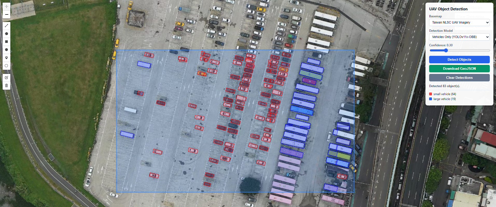

# UAV Vehicle Detection using YOLOv11-OBB

A web-based tool for detecting vehicles from UAV imagery using **YOLOv11 with Oriented Bounding Boxes (OBB)**. The system automatically fetches tiles from the Taiwan UAV WMTS service and performs vehicle detection in real-time. Detection results are visualized on a Leaflet map and can be downloaded as GeoJSON.

---

## Features

- Dedicated to **top-down satellite and UAV ortho imagery** (all pretrained models auto-download on demand):
  - **Vehicles (High Accuracy / Fast)**: `YOLOv11x-OBB` & `YOLOv11m-OBB` (`small vehicle`, `large vehicle`, DOTAv1)
  - **All 15 Aerial Classes**: Full DOTAv1 multi-class OBB detection (`YOLOv11x-OBB`)
  - **Maritime, Aviation, Infrastructure & Sports**: Ships, harbors, aircraft, bridges, storage tanks, roundabouts, courts & pools (`YOLOv11x-OBB`)
  - **Buildings Footprint (Instance Segmentation)**: `keremberke/yolov8m-building-segmentation` (satellite/aerial building polygons)
  - **Roads & Land Cover (Semantic Segmentation)**: `geospaitial-lab/segformer-b3-potsdam-512-512` (ISPRS Potsdam aerial ortho — roads/impervious surfaces, buildings, trees, vegetation & cars)
- **Multiple basemaps** switchable directly in the Leaflet UI:
  - Taiwan NLSC UAV WMTS (`UAV111A03`)
  - Taiwan NLSC Ortho Photo (`PHOTO2`)
  - Taiwan NLSC e-Map (`EMAP`)
  - Esri World Imagery
  - Google Satellite
  - OpenStreetMap
- Interactive **web interface** using Leaflet with live basemap/model/confidence selectors, dynamic class legend, and rectangle ROI drawing.
- Export RFC 7946-compliant detection results as **GeoJSON** (`detection_<model>.geojson`).
- Integrates **YOLOv11-OBB** with **Python FastAPI** and **ngrok**.

---
## Structure

## Demo

Once the server is running, open the public URL generated by **ngrok**.  

1. Choose a **Basemap** and **Detection Model** (plus confidence threshold) from the top-right panel.
2. Draw a rectangle on the map to define the detection area.  
3. Click **Detect Objects** to run detection.  
4. Click **Download GeoJSON** to save results.  
5. Use **Clear Detections** to reset.



---
## Installation
1. Download the YOLOv11 OBB model from the following link: https://docs.ultralytics.com/tasks/obb/#visual-samples
2. Run the following in Google Colab:


```bash
!pip install -q ultralytics fastapi uvicorn pyngrok pillow nest_asyncio python-multipart rasterio mercantile
!wget -O ngrok-stable-linux-amd64.tgz https://bin.equinox.io/c/bNyj1mQVY4c/ngrok-v3-stable-linux-amd64.tgz
!tar -xvzf ngrok-stable-linux-amd64.tgz
!chmod +x ngrok
```


