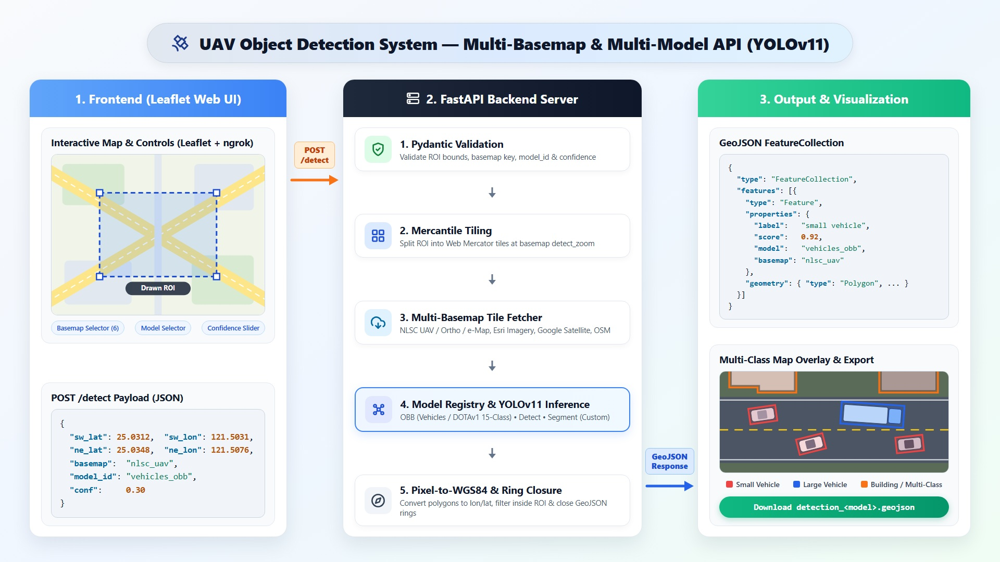

# UAV Vehicle Detection using YOLOv11-OBB

A web-based tool for detecting vehicles from UAV imagery using **YOLOv11 with Oriented Bounding Boxes (OBB)**. The system automatically fetches tiles from the Taiwan UAV WMTS service and performs vehicle detection in real-time. Detection results are visualized on a Leaflet map and can be downloaded as GeoJSON.

---

## Features

- Detect **small and large vehicles** as well as **multi-class aerial objects** (DOTAv1 15 classes, general objects, and pluggable custom **building** / **road-marking** models).
- Supports **OBB (`obb`)**, **Detection (`detect`)**, and **Segmentation (`segment`)** YOLO models through a unified `MODEL_REGISTRY`.
- **Multiple basemaps** switchable directly in the Leaflet UI:
  - Taiwan NLSC UAV WMTS (`UAV111A03`)
  - Taiwan NLSC Ortho Photo (`PHOTO2`)
  - Taiwan NLSC e-Map (`EMAP`)
  - Esri World Imagery
  - Google Satellite
  - OpenStreetMap
- Interactive **web interface** using Leaflet with live basemap/model/confidence selectors, dynamic class legend, and rectangle ROI drawing.
- Export RFC 7946-compliant detection results as **GeoJSON** (`detection_<model>.geojson`).
- Integrates **YOLOv11** with **Python FastAPI** and **ngrok**.

---
## Structure

## Demo

Once the server is running, open the public URL generated by **ngrok**.  

1. Choose a **Basemap** and **Detection Model** (plus confidence threshold) from the top-right panel.
2. Draw a rectangle on the map to define the detection area.  
3. Click **Detect Objects** to run detection.  
4. Click **Download GeoJSON** to save results.  
5. Use **Clear Detections** to reset.


---
## Future Work
- [x] Add support for additional basemaps (NLSC UAV / Ortho / e-Map, Esri World Imagery, Google Satellite, OpenStreetMap).
- [x] Integrate more detection models (`MODEL_REGISTRY` supporting multi-class DOTAv1 OBB, general YOLOv11 detection, and pluggable custom building/road-marking segmentation or OBB weights).
- [ ] Add batch/asynchronous tile fetching and cross-tile NMS deduplication for large ROIs.
  
## Installation
1. Download the YOLOv11 OBB model from the following link: https://docs.ultralytics.com/tasks/obb/#visual-samples
2. Run the following in Google Colab:


```bash
!pip install -q ultralytics fastapi uvicorn pyngrok pillow nest_asyncio python-multipart rasterio mercantile
!wget -O ngrok-stable-linux-amd64.tgz https://bin.equinox.io/c/bNyj1mQVY4c/ngrok-v3-stable-linux-amd64.tgz
!tar -xvzf ngrok-stable-linux-amd64.tgz
!chmod +x ngrok
```


